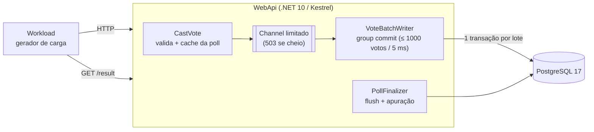

# Voting: votação do paredão

API de votação de alta vazão para um "paredão": **3 participantes**, votação aberta por **30 segundos**, e quem tiver a **maior porcentagem** de votos é eliminado. Em caso de empate na maior porcentagem, o resultado declara empate e ninguém é eliminado. Os votos chegam pela API pública, a mesma usada por um eleitor real, e um gerador de carga simula milhares de eleitores.

Requisitos principais (ver [spec](specs/001-paredao-voting/spec.md)):
- sustentar **10.000 votos/s** durante os 30 s (SC-001), com **p95 ≤ 200 ms** (SC-008);
- voto confirmado é **durável**: sobrevive a quedas e nunca se perde nem duplica;
- resultado disponível em até 5 s após o fechamento, com porcentagens somando exatamente 100,00.

## Arquitetura

- **Group commit**: os votos entram numa fila em memória e são gravados em lotes, com uma transação por lote. O `201` só é devolvido depois do commit.
- **Idempotência**: cada voto leva uma `Idempotency-Key`. Reenviar com a mesma chave devolve o mesmo voto (`200`) sem duplicar.
- **Backpressure**: com a fila cheia, a API responde `503 overloaded`, e o cliente pode reenviar com a mesma chave.
- **Finalização**: ao fechar, o writer é esvaziado (flush), os votos são apurados por maiores restos e o resultado é gravado em `poll_results`. A finalização também roda na inicialização, para recuperar uma queda (FR-020).

O detalhamento completo, com diagrama de sequência, estratégias e infraestrutura, está no [relatório de capacidade da v0](benchmarks/v0/relatorio-v0.md#2-como-a-v0-funciona).

## Endpoints

| Método | Rota | Descrição |
|---|---|---|
| `POST` | `/polls` | Cria um paredão com 3 participantes |
| `GET` | `/polls/{pollId}` | Consulta o paredão e o status |
| `POST` | `/polls/{pollId}/open` | Abre a votação (`closesAt = openedAt + 30 s`) |
| `POST` | `/polls/{pollId}/votes` | Vota (header `Idempotency-Key` obrigatório) |
| `GET` | `/polls/{pollId}/result` | Resultado final (`409` enquanto não finalizado) |

Contrato completo: [`voting-api.openapi.yaml`](specs/001-paredao-voting/contracts/voting-api.openapi.yaml). Erros seguem Problem Details, com `code` (ex.: `voting_closed`, `idempotency_key_conflict`, `overloaded`).

## Como rodar

Pré-requisitos: .NET SDK 10 e Docker em execução (portas `5080` e `5432` livres).

| Comando | O que faz |
|---|---|
| `make setup` | Verifica pré-requisitos, sobe o PostgreSQL e compila |
| `make test` | Testes unitários e de integração (Testcontainers sobe um PostgreSQL próprio) |
| `make run` | Sobe a API em `http://localhost:5080` |
| `make load` | Sobe a API e roda o gerador a 10.000 votos/s (`RATE`, `DURATION` etc. configuráveis) |
| `make stress BENCH_VERSION=<v>` | Rampa até a ruptura e gera o benchmark em `benchmarks/<v>/` (**recria o banco local**) |
| `make down` | Para o PostgreSQL |

## Resultados

| Medição | Resultado | Fonte |
|---|---|---|
| Carga de 10.000 votos/s (SC-001) | ✅ p95 de 8,5 ms; todas as checks aprovadas | [validation.md](specs/001-paredao-voting/validation.md) |
| Queda da API no meio da votação (FR-020) | ✅ nenhum voto perdido ou duplicado | [validation.md](specs/001-paredao-voting/validation.md) |
| Capacidade da v0 | **15.000 votos/s** sustentáveis; ruptura entre 20.000 e 21.000 votos/s (medido na bateria) | [relatorio-v0.md](benchmarks/v0/relatorio-v0.md) |

## Documentação

- [Especificação](specs/001-paredao-voting/spec.md) · [Plano](specs/001-paredao-voting/plan.md) · [Tarefas](specs/001-paredao-voting/tasks.md) · [Modelo de dados](specs/001-paredao-voting/data-model.md)
- [Quickstart de validação](specs/001-paredao-voting/quickstart.md) · [Validação](specs/001-paredao-voting/validation.md)
- [Benchmarks](benchmarks/README.md)
