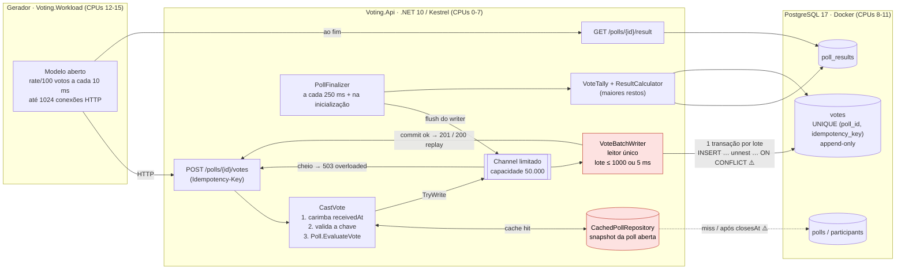

# Relatório de capacidade: v0

**Data da execução**: 2026-11-02, 23:15–23:21 (UTC-3) | **Commit**: `6218bfa` | **Feature**: `001-paredao-voting`
**Dados brutos**: [`raw/`](raw/) | **Resumo gerado automaticamente**: [`README.md`](README.md), [`summary.json`](summary.json)

> ⚠️ **Ambiente degradado.** A execução rodou num notebook **na bateria** (17%, descarregando), com perfil de energia
> `power-saver`, governor `powersave` e clock limitado a 2,0 GHz. Os números abaixo são o baseline **desse** ambiente.
> A próxima medição deve ser feita na tomada, com perfil `performance`. A partir de agora o `stress.sh` registra o estado
> de energia e o `compare.py` avisa quando ele diverge entre duas execuções.

## 1. Resultado

| Indicador | Valor |
|---|---|
| **Capacidade sustentável** (todas as execuções aprovadas) | **15.000 votos/s** (p95 de 11,0 ms) |
| **Faixa de ruptura** | **entre 20.000 e 21.000 votos/s** |
| 20.000 votos/s | instável: aprovado em 1 de 4 execuções |
| Requisito SC-001 | 10.000 votos/s → **atendido com folga de 50%** |
| Integridade sob sobrecarga | `acceptedEqualsTotalVotes` e `noDuplicatesFromReplays` **verdadeiros em todas as execuções**, inclusive nas reprovadas |
| `overloaded` (503) / erros de transporte | 0 / 0 em todas as execuções |

Em uma frase: a v0 sustenta 15k votos/s com p95 de ~11 ms. Perto de 20k votos/s ela passa de dezenas de milissegundos para
**segundos** de latência, sem perder nem duplicar votos, e o gargalo não é CPU.

## 2. Como a v0 funciona

### 2.1 Arquitetura e fluxo de um voto



Em vermelho, os componentes apontados como gargalo (ver [seção 5](#5-análise-do-gargalo)).

### 2.2 Ciclo de vida de um voto

```mermaid
sequenceDiagram
    autonumber
    participant G as Gerador
    participant A as API (CastVote)
    participant C as Channel (50k)
    participant W as VoteBatchWriter
    participant P as PostgreSQL

    G->>A: POST /polls/{id}/votes + Idempotency-Key
    A->>A: receivedAt = agora (antes de qualquer I/O)
    A->>A: poll do cache → EvaluateVote (janela de 30 s, participante válido)
    alt fila cheia
        A-->>G: 503 overloaded → gerador reenvia com a mesma chave (1 s, 2 s)
    else enfileirado
        A->>C: TryWrite(voto)
        W->>C: drena até 1000 votos ou 5 ms
        W->>P: BEGIN; INSERT … unnest … ON CONFLICT DO NOTHING RETURNING id
        opt chaves já existentes no lote
            W->>P: SELECT dos votos originais (replay ou conflito)
        end
        W->>P: COMMIT
        W-->>A: resultado de cada voto do lote
        A-->>G: 201 (novo) · 200 (replay, mesmo voteId) · 409 (chave com outro participante)
    end
```

### 2.3 Estratégias adotadas para chegar a esse resultado

| Estratégia | Onde | Por quê |
|---|---|---|
| **Group commit**: 1 transação por lote de até 1000 votos, inserido com `unnest` | `VoteBatchWriter` | Divide o custo de `fsync`/commit por até 1000 votos; 1 transação por voto não chegaria a 10k/s. |
| **Confirmação só após o commit** | `VoteBatchWriter` (`TaskCompletionSource` por voto) | `201` significa que o voto é durável (FR-008): uma queda nunca perde voto confirmado. |
| **Idempotência no banco**: `UNIQUE (poll_id, idempotency_key)` + `ON CONFLICT DO NOTHING` + releitura | `votes` / `VoteBatchWriter` | Reenvio com a mesma chave devolve o mesmo voto (`200`) sem duplicar (FR-017, SC-004); mesma chave com outro participante dá `409`. |
| **Cache da poll aberta** | `CachedPollRepository` | Enquanto a janela está aberta, a poll é imutável: nenhum voto lê `polls` no banco. |
| **Backpressure explícita**: fila limitada (50k) → `503 overloaded` | `Channel` em `VoteBatchWriter` | Sob excesso, recusa de forma visível e reenviável, em vez de crescer memória ou latência sem limite. |
| **`receivedAt` carimbado na chegada** | `CastVote` | O tempo em fila não conta contra o eleitor: um voto que chegou dentro da janela vale, mesmo que seja gravado depois. |
| **Flush antes de apurar** | `PollFinalizer` → `FlushUntilAsync` | A apuração só roda depois que todos os votos recebidos até `closesAt` foram gravados (SC-002). |
| **Apuração por maiores restos** | `ResultCalculator` | Porcentagens com 2 casas que somam exatamente 100,00 (SC-006). |
| **Uma poll aberta por vez** | índice parcial `one_open_poll` | Garante FR-019 no próprio banco, sem lock na aplicação. |
| **`votes` append-only** | trigger `votes_append_only` | Nenhum `UPDATE`/`DELETE` em voto, nem pelo dono da tabela (FR-009). |
| **Recuperação na inicialização** | `PollFinalizer` | Se a API cair, o `closesAt` persistido continua valendo e as polls vencidas são apuradas ao subir (FR-020). |
| **Gerador em modelo aberto** | `LoadRunner` | O ritmo de envio não depende das respostas, então a lentidão do servidor aparece na latência em vez de reduzir a carga. |

### 2.4 Infraestrutura

| Item | v0 |
|---|---|
| Runtime | .NET SDK 10.0.114, minimal API sobre Kestrel, build `Release`, **uma instância** |
| Acesso a dados | Npgsql `NpgsqlDataSource`, pool padrão (**máx. 100 conexões**), compartilhado pelo writer, repositórios e apuração |
| Banco | PostgreSQL 17.11 (imagem oficial, `docker compose`), **configuração padrão**: `shared_buffers` 128 MB, `max_wal_size` 1 GB, `synchronous_commit = on` |
| Schema | `polls`, `participants`, `votes` (PK, `UNIQUE (poll_id, idempotency_key)`, índice `(poll_id, participant_id)`), `poll_results` |
| Writer | `MaxBatchSize = 1000`, `MaxBatchDelay = 5 ms`, `Capacity = 50.000` (padrões) |
| Rede | Tudo em `localhost`, sem proxy, balanceador ou TLS |
| Máquina | AMD Ryzen 7 5825U (8 núcleos / 16 threads), 14 GiB de RAM, Linux 7.0.0-42, **na bateria** |
| Isolamento | `taskset`/`cpuset`: API em `0-7` (4 núcleos físicos), PostgreSQL em `8-11` (2 núcleos), gerador em `12-15` (2 núcleos) |

## 3. Metodologia

- Ferramenta: `make stress BENCH_VERSION=v0` (`tools/stress/stress.sh`). O banco é recriado no início, e há um warm-up de 2.000 votos/s por 10 s, descartado.
- Rampa `10k → 15k → 20k → 25k → 30k → 40k → 50k → 60k` votos/s, cada degrau com uma **poll nova** e **30 s** de envio, distribuição `50,30,20`, `--retry-fraction 0.05` e 1024 conexões.
- A rampa para no primeiro degrau reprovado, faz busca binária entre o último aprovado e o primeiro reprovado (passo mínimo de 1.000 votos/s) e **repete 2 vezes** o maior degrau aprovado.
- Um degrau é aprovado se:
  - `achievedRate` ≥ 98% do alvo;
  - não houver nenhuma rejeição além de `voting_closed` nem erros de transporte;
  - as checks `acceptedEqualsTotalVotes`, `noDuplicatesFromReplays` e `p95WithinTarget` (p95 ≤ 200 ms, SC-008) forem verdadeiras.
- Uma taxa é **sustentável** se todas as suas execuções forem aprovadas.
- CPU e memória são amostradas a cada 1 s (`tools/stress/sample.py`) durante a janela de envio.
- Os degraus rodaram nesta ordem: `ramp-10000`, `ramp-15000`, `ramp-20000`, `ramp-25000`, `refine-22500`, `refine-21000`, `confirm-20000-1`, `confirm-20000-2`. Depois foi feito um experimento extra com a tabela `votes` truncada e a API reiniciada.

## 4. Dados

### 4.1 Vazão e latência

| Degrau | Alvo (votos/s) | Alcançado (votos/s) | Enviados | Aceitos | Aceitos/s | Reenvios (`replayed`) | `voting_closed` | p50 (ms) | p95 (ms) | p99 (ms) | max (ms) | Resultado |
|---|---:|---:|---:|---:|---:|---:|---:|---:|---:|---:|---:|---|
| `ramp-10000` | 10.000 | 9.997,3 | 300.000 | 299.874 | 9.996 | 14.925 | 129 | 6,5 | 8,4 | 14,2 | 46,2 | ✅ |
| `ramp-15000` | 15.000 | 14.997,4 | 450.000 | 449.752 | 14.992 | 22.529 | 248 | 7,8 | 11,0 | 26,1 | 61,3 | ✅ |
| `ramp-20000` | 20.000 | 19.994,4 | 600.000 | 599.698 | 19.990 | 29.925 | 309 | 9,6 | 21,6 | 52,6 | 124,4 | ✅ |
| `ramp-25000` | 25.000 | 24.993,3 | 750.000 | 684.728 | 22.824 | 32.237 | 67.351 | 13,7 | 4.505,3 | 4.886,6 | 5.086,0 | ❌ p95 |
| `refine-22500` | 22.500 | 22.495,5 | 675.000 | 477.506 | 15.917 | 16.974 | 204.542 | 6.191,2 | 9.071,8 | 9.194,0 | 9.283,3 | ❌ p95 |
| `refine-21000` | 21.000 | 20.991,9 | 630.000 | 481.179 | 16.039 | 18.373 | 154.591 | 4.820,2 | 7.501,9 | 7.813,6 | 7.942,8 | ❌ p95 |
| `confirm-20000-1` | 20.000 | 19.978,1 | 600.000 | 476.871 | 15.896 | 19.605 | 127.538 | 3.610,0 | 6.450,8 | 6.627,4 | 6.738,5 | ❌ p95 |
| `confirm-20000-2` | 20.000 | 19.465,1 | 600.000 | 447.035 | 14.901 | 17.591 | 157.872 | 4.357,2 | 8.334,6 | 8.784,5 | 8.987,7 | ❌ p95, `achievedRate` |
| extra: 20k, tabela vazia | 20.000 | 19.976,6 | 600.000 | 362.477 | 12.083 | 11.305 | 244.350 | 8.353,2 | 11.318,5 | 11.462,2 | 11.571,9 | ❌ p95 |

- **Aceitos/s** = votos aceitos dentro dos 30 s da janela ÷ 30, ou seja, a vazão que o servidor de fato gravou.
- Em todas as linhas, `result.totalVotes` = `accepted` (nenhum voto confirmado ficou de fora, nenhum duplicado).
- O experimento extra está em [`raw/extra/exp-20000-empty-table.json`](raw/extra/exp-20000-empty-table.json).

```text
p95 por degrau (ms, escala log)
  10000 ok   ▏ 8,4
  15000 ok   ▎ 11,0
  20000 ok   ▌ 21,6
  25000 FAIL ████████████████████████ 4.505
  22500 FAIL ███████████████████████████ 9.072
  21000 FAIL ██████████████████████████ 7.502
  20000 FAIL █████████████████████████ 6.451   (confirm-1)
  20000 FAIL ██████████████████████████ 8.335  (confirm-2)
```

### 4.2 Uso de CPU (média na janela de envio; pico entre parênteses)

Percentual das CPUs reservadas a cada componente: 100% da API = 8 CPUs lógicas; do PostgreSQL e do gerador = 4.

| Degrau | API | PostgreSQL | Gerador |
|---|---:|---:|---:|
| `ramp-10000` | 16% (19%) | 9% (10%) | 11% (25%) |
| `ramp-15000` | 21% (29%) | 12% (15%) | 15% (34%) |
| `ramp-20000` | 27% (35%) | 14% (16%) | 21% (45%) |
| `ramp-25000` | 34% (53%) | 21% (77%) | 33% (63%) |
| `refine-22500` | 32% (44%) | 22% (57%) | 52% (75%) |
| `refine-21000` | 32% (43%) | 22% (68%) | 52% (77%) |
| `confirm-20000-1` | 31% (48%) | 22% (76%) | 50% (76%) |
| `confirm-20000-2` | 30% (44%) | 22% (71%) | 48% (65%) |

### 4.3 Memória (pico)

| Degrau | RSS da API (MB) | PostgreSQL (MB) | RSS do gerador (MB) |
|---|---:|---:|---:|
| `ramp-10000` | 186 | 474 | 183 |
| `ramp-15000` | 201 | 958 | 220 |
| `ramp-20000` | 220 | 1.468 | 306 |
| `ramp-25000` | 277 | 1.822 | 896 |
| `refine-22500` | 271 | 1.866 | 2.248 |
| `refine-21000` | 278 | 1.458 | 2.135 |
| `confirm-20000-1` | 294 | 1.738 | 1.416 |
| `confirm-20000-2` | 264 | 1.953 | 1.895 |

### 4.4 Linha do tempo: 20k aprovado × 20k reprovado

Progresso a cada 5 s, registrado pelo gerador:

| t | `ramp-20000` ✅ aceitos / em voo | `confirm-20000-1` ❌ aceitos / em voo |
|---:|---:|---:|
| 5 s | 99.581 / 45 | 71.483 / 16.693 |
| 10 s | 199.642 / 202 | 154.390 / 45.340 |
| 15 s | 299.552 / 201 | 242.988 / 56.840 |
| 20 s | 398.950 / 808 | 324.539 / 74.696 |
| 25 s | 499.552 / 202 | 392.242 / 97.063 |
| 30 s | 599.488 / 408 | 475.870 / 123.486 |

### 4.5 Estado do banco ao final

- `votes`: 3.936.643 linhas, 474 MB de heap.
- Índices: `votes_poll_idempotency_key_key` 379 MB, `votes_pkey` 119 MB, `votes_poll_participant_idx` 41 MB, contra `shared_buffers` de 128 MB.
- Checkpoints disparados por WAL (`max_wal_size`) a cada ~80 s, cada um escrevendo 4–6 mil buffers.

## 5. Análise do gargalo

**Comportamento na ruptura.** A degradação não é gradual: a 20k votos/s aprovados, o p95 é de 21,6 ms. Basta uma execução em
que a vazão de serviço fique abaixo da de chegada para a fila crescer durante os 30 s inteiros. Veja a seção 4.4: no
`confirm-20000-1`, o servidor já gravava apenas ~14–17k/s nos primeiros 5 s. Os votos ficam esperando, chegam
ao processamento depois do `closesAt` e voltam como `voting_closed` (até 244 mil por execução). Nenhum `503 overloaded`
aparece, porque o gerador tem no máximo 1024 requisições abertas: o backlog fica **no cliente**, e a fila de 50k do
writer nunca enche.

**Descartados:**
- *CPU*: a API usou no máximo ~34% das 8 CPUs dela, e o PostgreSQL ~22% das 4 dele, em média.
- *Volume de dados acumulado*: o experimento extra, com a tabela `votes` vazia e a API reiniciada, também falhou a 20k/s
  (p95 de 11,3 s).
- *Gerador*: só sai do ritmo (`achievedRate` < 98%) em `confirm-20000-2`, e mesmo assim por pouco (97,3%). A heurística
  automática do `README.md` gerado aponta o "generator" apenas porque ele foi o componente mais ocupado; essa conclusão
  não procede.

**Gargalos prováveis.** São hipóteses tiradas da leitura do código e do comportamento observado; ainda não foram medidas isoladamente.

1. **Writer serializado** (`VoteBatchWriter`): um leitor único grava **um lote por vez numa única conexão**. A vazão
   máxima é ~`1000 votos ÷ (tempo de montar o lote + INSERT + COMMIT)`. Esse teto não usa as CPUs livres e é sensível ao
   clock de uma única thread, o que bate com o ambiente na bateria a 2,0 GHz e com a variação entre execuções da mesma taxa.
   Os checkpoints a cada ~80 s (full-page writes em índices com chave aleatória) aumentam o tempo de commit de forma
   intermitente e podem explicar por que 20k passou uma vez e falhou nas seguintes.
2. **Cache da poll desligado após o `closesAt`** (`CachedPollRepository`): entre o fechamento e a finalização, cada voto
   atrasado lê `polls` no banco. Com dezenas de milhares de votos em backlog, essas leituras ocupam o pool do Npgsql
   (100 conexões), disputam conexão com o writer e atrasam a finalização. No experimento extra, o PostgreSQL chegou a
   recusar conexões (`FATAL: sorry, too many clients already`).
3. **Pool de conexões único e no limite do PostgreSQL**: o pool padrão do Npgsql (100) é igual ao `max_connections` do
   PostgreSQL (100). O writer não tem conexão reservada.

## 6. Próximos passos (v1)

1. **Remedir a v0 na tomada** com `powerprofilesctl set performance`, para ter um baseline justo antes de mudar o código.
2. **Instrumentar o writer**: histogramas de tamanho do lote, tempo de commit e profundidade da fila (logs ou métricas), para confirmar o gargalo 1.
3. **Paralelizar a gravação**: N writers ou pipeline (montar o próximo lote enquanto o anterior faz commit), avaliando `COPY` binário no lugar de `INSERT … unnest`.
4. **Cachear a poll fechada até a finalização** e evitar o *thundering herd* no primeiro acesso de uma poll nova.
5. **Pool dedicado ou conexão reservada para o writer**, e ajustar `max_connections`.
6. **Tuning do PostgreSQL**: `shared_buffers`, `max_wal_size` e `checkpoint_timeout`, e avaliar uma chave de idempotência com melhor localidade.
7. Repetir com `make stress BENCH_VERSION=v1` e comparar com `python3 tools/stress/compare.py benchmarks/v0 benchmarks/v1`.

## 7. Como reproduzir

```bash
make stress BENCH_VERSION=v0-ac   # ATENÇÃO: recria o banco local; rode na tomada
python3 tools/stress/compare.py benchmarks/v0 benchmarks/v0-ac
```

Variáveis úteis: `RATES`, `DURATION`, `CONNECTIONS`, `API_CPUS`, `PG_CPUS`, `GEN_CPUS`, `REFINE`, `CONFIRM_RUNS` (ver `tools/stress/stress.sh`).
